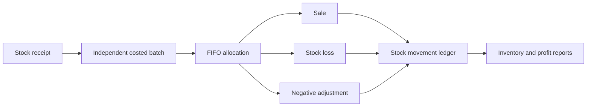

# Frozen Food Inventory & Sales Management System

[](https://www.php.net/)
[](https://laravel.com/)
[](https://livewire.laravel.com/)
[](https://tailwindcss.com/)
[](https://www.mysql.com/)

A mobile-first inventory, point-of-sale, and reporting application for a single frozen-food store. It tracks stock in kilograms, preserves the cost of every delivery batch, allocates deductions using FIFO, and keeps sales, losses, expenses, refunds, and stock corrections auditable.

The interface supports separate administrator and cashier responsibilities while using one secure login form. It is designed for local XAMPP installation and conventional PHP/MySQL hosting.

> No administrator password is included in the source code. On a new installation, the owner creates the first administrator through the one-time `/setup` screen.

## Highlights

- Mobile-first administrator and cashier dashboards
- Livewire point of sale for sales by customer amount or kilograms
- Exact decimal-safe money and kilogram calculations
- Independently costed stock batches and FIFO allocation
- Stock receiving, adjustments, movement ledger, and live balances
- Spoiled, damaged, missing, and freezer-failure stock records
- Immutable sales history, printable thermal receipts, refunds, and reversals
- Product categories, selling prices, images, and low-stock thresholds
- Administrator-managed cashier accounts with activation and password reset
- Business profile, store logo, receipt branding, and Naira formatting
- Operating expenses with correction history
- Revenue, FIFO COGS, gross profit, losses, expenses, and estimated net profit
- Responsive Chart.js analytics and protected CSV exports
- In-app low-stock, out-of-stock, adjustment, and loss notifications
- Private image storage with controlled delivery and MIME validation

## Screenshots

The screenshot gallery is being captured during the final real-browser acceptance pass. The required pages, filenames, viewport sizes, and privacy checks are documented in [the screenshot guide](docs/screenshots/README.md).

<!-- SCREENSHOT_GALLERY_START
The verified screenshot gallery will be inserted here after capture.
SCREENSHOT_GALLERY_END -->

## Roles

| Capability | Administrator | Cashier |
|---|:---:|:---:|
| Use the POS | Yes | Yes |
| View own sales and receipts | Yes | Yes |
| View all store sales | Yes | No |
| Manage products and categories | Yes | No |
| Receive, adjust, or record lost stock | Yes | No |
| Manage cashier accounts and business settings | Yes | No |
| View costs, expenses, profit, and business reports | Yes | No |
| Reverse sales or stock losses | Yes | No |

Cashiers are restricted on the server, not only through hidden navigation. A deactivated account is denied on its next authenticated request.

## How inventory remains auditable



Available stock is always the sum of positive batch balances. Products do not contain a manually editable stock total, so receipt, sale, loss, and adjustment records cannot silently disagree with inventory.

All stock-changing operations use database transactions, row locks, idempotency keys, and decimal-string arithmetic. Purchase costs remain attached to the batches consumed by a sale or loss, allowing FIFO COGS and stock-loss values to be reported without using current selling prices.

## Technology

| Layer | Technology |
|---|---|
| Backend | PHP 8.2, Laravel 12 |
| Interactive UI | Livewire 4, Alpine.js |
| Styling | Blade, Tailwind CSS 4 |
| Charts | Chart.js 4 |
| Build tooling | Vite 6 |
| Database | MySQL 8 or MariaDB with InnoDB |
| Testing | PHPUnit 11, Laravel feature tests |

Application timestamps are stored in UTC. Business-facing dates and reporting periods use `Africa/Lagos`.

## Local setup with XAMPP

### Requirements

- XAMPP using PHP 8.2 with PDO MySQL, OpenSSL, Fileinfo, DOM/XML, Mbstring, and Intl
- Composer 2
- Node.js and npm
- MySQL 8 or a current MariaDB release

### 1. Install dependencies

```powershell
composer install
npm install
```

### 2. Configure the environment

```powershell
Copy-Item .env.example .env
php artisan key:generate
```

Create a UTF-8 database named `frozen_food_inventory`, then review these values in `.env`:

```dotenv
APP_URL=http://127.0.0.1:8000
APP_TIMEZONE=UTC
BUSINESS_TIMEZONE=Africa/Lagos

DB_CONNECTION=mysql
DB_HOST=127.0.0.1
DB_PORT=3306
DB_DATABASE=frozen_food_inventory
DB_USERNAME=root
DB_PASSWORD=
DB_TIMEZONE=+00:00
```

Never commit `.env` or real credentials.

### 3. Create the database tables and editable defaults

```powershell
php artisan migrate --seed
```

The seeders add editable product and expense categories only. They never create users or default passwords.

### 4. Start the application

Run these in separate terminals:

```powershell
php artisan serve
```

```powershell
npm run dev
```

Open [http://127.0.0.1:8000](http://127.0.0.1:8000).

### 5. Create the owner account

On an empty installation, `/login` redirects to `/setup`. The owner chooses the first administrator credentials and is signed in automatically. The setup page closes permanently once an administrator exists.

For a console-only installation, use the hidden interactive prompts:

```powershell
php artisan app:create-administrator
```

Public registration is disabled. After initialization, administrators and cashiers both sign in at `/login`; each role is redirected to its authorized dashboard.

## First-use workflow

1. Complete the one-time administrator setup.
2. Configure store and receipt details under **Business settings**.
3. Review or edit the seeded product categories.
4. Register products and their selling prices per kilogram.
5. Receive the first delivery for each product to create stock batches.
6. Create cashier accounts under **Staff management**.
7. Start selling from **Point of sale**.

## Testing and quality checks

```powershell
php artisan test
vendor\bin\pint --test
php artisan view:cache
npm run build
composer validate --strict
composer audit
npm audit --audit-level=moderate
```

The default PHPUnit configuration uses an in-memory SQLite database and does not touch the configured MySQL application database. MySQL verification must use a separate disposable schema—never the live store database.

See [Testing and acceptance](docs/TESTING.md) for the business reconciliation, security, concurrency, receipt-printing, and responsive-browser checklists.

## Security notes

- Public registration and hardcoded administrator credentials are absent.
- Passwords use Laravel hashing, sessions rotate at login/logout, and login attempts are rate-limited.
- Authorization is enforced by authentication, active-account, role middleware, policies, and Livewire action checks.
- Logo and product uploads accept validated JPG/JPEG, PNG, and WebP images only.
- Uploaded originals live outside the web root and are returned through controlled media routes with `nosniff` headers.
- Financial and inventory history is corrected through audited adjustments or reversals rather than deletion.
- Production must use HTTPS, `APP_DEBUG=false`, secure session cookies, restricted filesystem permissions, and a web root pointed only at `public`.

Please report security issues privately to the repository owner instead of opening a public issue with exploit details.

## Production deployment

Review [the deployment guide](docs/DEPLOYMENT.md) before hosting. It covers Apache/XAMPP, shared hosting, environment hardening, private uploads, optimized builds, migrations, backups, and release verification.

Core operation does not require Redis, a queue worker, a paid printer service, or an external notification provider.

## Documentation

- [Project specification](docs/PROJECT_SPEC.md)
- [Application architecture](docs/ARCHITECTURE.md)
- [Module roadmap](docs/MODULE_ROADMAP.md)
- [Deployment guide](docs/DEPLOYMENT.md)
- [Testing and acceptance](docs/TESTING.md)
- [Final review report](docs/MODULE_13_REPORT.md)
- [Master development prompt](Frozen%20Food%20Inventory%20and%20Sales%20Management%20System.md)

## Project status

Modules 01–12 are implemented and covered by automated tests. Module 13's code, security, deployment, SQLite, and MySQL checks are complete; final real-browser viewport acceptance and screenshot capture remain pending. See the [module roadmap](docs/MODULE_ROADMAP.md) for details.
